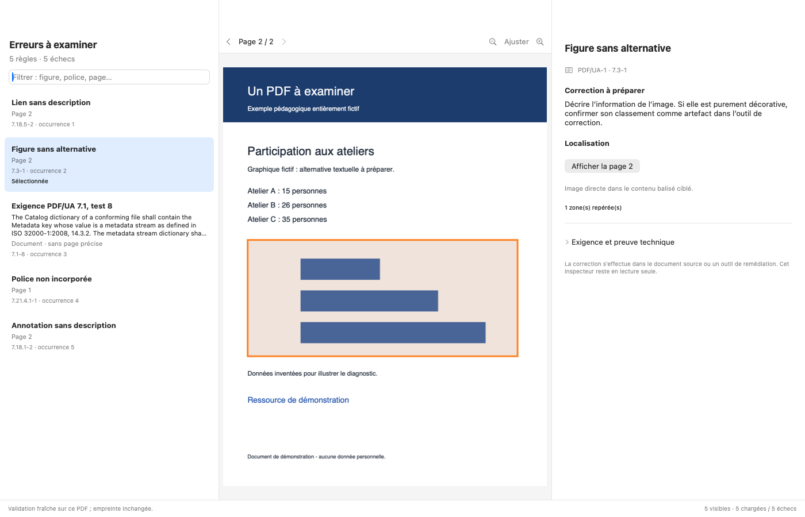

# veraPDF Mac Inspecteur

**Retrouvez dans vos PDF les erreurs d’accessibilité signalées par veraPDF et préparez leur correction.**

L’application affiche le document, les erreurs et leur explication dans une même
fenêtre. Votre PDF reste sur votre Mac et n’est pas modifié par l’inspecteur.
Le contrôle porte sur **PDF/UA-1** ; les corrections se font dans un autre outil.

[Premier contrôle](#votre-premier-contrôle) · [Installer](docs/installation.md) · [Dépannage](#si-vous-rencontrez-un-problème)

## Par où commencer ?

| Votre situation | La prochaine étape |
|---|---|
| L’application est déjà installée | Ouvrez **veraPDF Mac Inspecteur** depuis le Finder ou votre raccourci dans le Dock, puis suivez les cinq étapes ci-dessous. |
| Vous voulez l’installer sur un autre Mac | Consultez d’abord la [compatibilité](docs/compatibilite.md), puis le [guide d’installation](docs/installation.md). Le dépôt fournit les sources, sans installateur prêt à télécharger. |

**Compatibilité actuelle :** le binaire local vérifié est compilé pour Apple
Silicon avec une cible **macOS 14.0**, cohérente avec le paquet.
L’exécution est vérifiée sur macOS 27.0 ; les anciens macOS et les Mac Intel
restent à qualifier. Voir les [prérequis détaillés](docs/compatibilite.md).

## Votre premier contrôle

1. **Ouvrez le document.** Cliquez sur **Ouvrir un PDF** et choisissez votre fichier : l’analyse démarre automatiquement.
2. **Attendez le diagnostic.** Vous pouvez interrompre le traitement avec **Annuler**.
3. **Choisissez une erreur à gauche.** Le titre et la page vous aident à sélectionner une occurrence.
4. **Examinez la page et le conseil.** Le PDF apparaît au centre ; à droite, lisez **Correction à préparer** et les précisions de localisation.
5. **Corrigez, puis recontrôlez.** Modifiez le document source ou une copie avec votre outil de remédiation, puis ouvrez le PDF corrigé dans l’inspecteur.

Vous devez retrouver l’erreur sélectionnée, son explication et, si elle est
connue, sa page. Un cadre orange apparaît seulement lorsqu’une zone est établie.

## Se repérer dans la fenêtre

| Zone | Ce que vous pouvez faire |
|---|---|
| **À gauche — les erreurs** | Sélectionnez une occurrence. Pour réduire la liste, saisissez par exemple « figure » ou « police » dans le filtre. Effacez-le pour retrouver toutes les occurrences chargées. |
| **Au centre — le PDF** | Feuilletez le document, agrandissez l’aperçu ou cliquez sur **Ajuster**. |
| **À droite — le diagnostic** | Lisez le conseil et ses limites. Le bouton **Afficher la page…** rejoint une page connue ; **Exigence et preuve technique** donne le détail du contrôle. |

Une **règle** est un contrôle ; une **occurrence** est un échec de ce contrôle.
Une règle peut produire de nombreuses occurrences et plusieurs règles peuvent
concerner le même objet. Une liste vide après filtrage ne signifie pas zéro erreur.

### Exemple : une figure sans alternative

L’erreur est sélectionnée à gauche, le graphique est encadré dans le PDF et
le conseil apparaît à droite.

Voir aussi un lien sans description

Le cadre suit le lien concerné ; le panneau explique la description à renseigner
dans son annotation.

Captures réelles sur un document entièrement fictif analysé par veraPDF,
sans document utilisateur. La barre d’outils native macOS n’est pas incluse.

## Comment interpréter la localisation ?

| Indication | Comment poursuivre votre examen |
|---|---|
| **Cadre orange** | Examinez la zone avec le diagnostic associé. |
| **Localisation partielle** | Le cadre couvre seulement une partie du contenu concerné : examinez aussi le reste de la page. |
| **Page connue, sans cadre** | La page est identifiée mais aucune zone précise n’est établie. Recherchez l’élément sur cette page. |
| **Sans localisation dans une page** | Le constat peut être global, par exemple des métadonnées manquantes, ou sa page reste inconnue. Consultez le diagnostic. |

**Pas de cadre ne veut pas dire pas de problème.** Les figures complexes,
certains textes et les polices ambiguës ne sont pas toujours localisables précisément.

## Refaire un contrôle ou garder un rapport

| Votre besoin | Commande |
|---|---|
| Contrôler à nouveau le PDF ouvert | **Analyser** : produit un nouveau contrôle avec veraPDF. |
| Examiner un rapport déjà disponible | **Importer un XML** : choisissez un rapport veraPDF **PDF/UA-1** correspondant au PDF ouvert. |
| Conserver le diagnostic pour votre suivi | **Enregistrer le XML** : choisissez un emplacement hors du dossier temporaire des rapports. |
| Interrompre l’attente | **Annuler** : le résultat précédent est conservé. |
| Retrouver ou nettoyer les rapports générés | Menu **Rapports** : ouvrir le dossier ou mettre les anciens rapports à la Corbeille. |

Un rapport importé peut être ancien. Pour vérifier l’état actuel du PDF,
utilisez **Analyser** : l’import seul ne prouve pas que le document est resté identique.

Les rapports générés au-delà des **50 plus récents** ou de **30 jours** rejoignent
la Corbeille ; le rapport affiché est protégé. Les copies enregistrées ailleurs
ne sont pas concernées. Votre PDF ne fait pas partie de ce nettoyage.

## Si vous rencontrez un problème

| Situation | Action conseillée |
|---|---|
| **veraPDF est introuvable** | Vérifiez son installation et son chemin. L’application essaie `/opt/homebrew/bin/verapdf`, ou le chemin absolu transmis par `VERAPDF_COMMAND` ; elle ne le recherche pas automatiquement. Suivez le [guide des chemins](docs/compatibilite.md#comment-lapplication-trouve-verapdf). |
| **L’import XML est refusé** | Vérifiez qu’il s’agit d’un rapport PDF/UA-1 associé à ce PDF, ou utilisez **Analyser** pour en produire un nouveau. Le résultat précédent reste disponible. |
| **La liste est vide** | Effacez le filtre et consultez le nombre total d’échecs. |
| **Diagnostic incomplet** | Lisez les compteurs du bandeau. Le rapport ou le plafond de 2 000 occurrences limite les détails. Examinez les erreurs disponibles et recontrôlez après correction ; **Analyser** peut aussi compléter un ancien rapport importé. |
| **Le traitement prend trop longtemps** | Utilisez **Annuler**. Le traitement complet est borné à environ trois minutes. Limites de fichiers : PDF de 256 Mio, XML de 64 Mio. |
| **Une exigence est en anglais** | Certaines règles ont un conseil spécifique en français ; pour les autres, l’exigence originale reste visible avec la mention **traduction indisponible** dans le détail. |
| **L’application ne démarre plus après un déplacement** | Le chemin de Python peut ne plus être valable. Consultez [Installation et maintenance](docs/installation.md#après-un-déplacement-ou-une-mise-à-jour). |

## Avant d’installer sur un autre Mac

Il faut **Python 3.12**, **pikepdf**, **PyMuPDF** et, pour produire une validation,
**veraPDF CLI avec son environnement Java fonctionnel**. Les outils Swift sont
nécessaires pour construire l’application. Ces composants ne sont pas embarqués.

Les chemins ne sont pas découverts automatiquement. Un double-clic dans le
Finder ou le Dock ne reprend pas nécessairement `VERAPDF_COMMAND` défini dans
votre Terminal. La [fiche de compatibilité](docs/compatibilite.md) explique les
chemins, le minimum macOS réellement observé et les limites de portabilité.

## Quand il n’y a plus d’échecs

Un rapport à **zéro échec** signifie que le contrôle automatique n’a rien signalé.
Il reste à vérifier la pertinence des alternatives, l’ordre de lecture et
l’utilisation réelle avec un lecteur d’écran. L’inspecteur ne corrige pas le
PDF et ne délivre pas une certification d’accessibilité.

## Ressources et documentation

| Ressource officielle veraPDF | Utilité |
|---|---|
| [Organisation GitHub](https://github.com/veraPDF) | Tous les dépôts officiels. |
| [veraPDF-apps](https://github.com/veraPDF/veraPDF-apps) | Sources de la CLI appelée par cet inspecteur, de la GUI et de l’installateur veraPDF. |
| [Profils et règles](https://github.com/veraPDF/veraPDF-validation-profiles) | Règles et profils de contrôle. |
| [Corpus de tests](https://github.com/veraPDF/veraPDF-corpus) | PDF témoins PDF/A et PDF/UA, non embarqués dans notre application. |

La [documentation de cet inspecteur](docs/README.md) donne accès à l’installation,
à la genèse, aux spécifications et aux preuves de vérification.

Ce projet indépendant n’est pas un produit officiel veraPDF. La version actuelle
prend en charge PDF/UA-1, sans profils PDF/UA-2 ou WTPDF.
