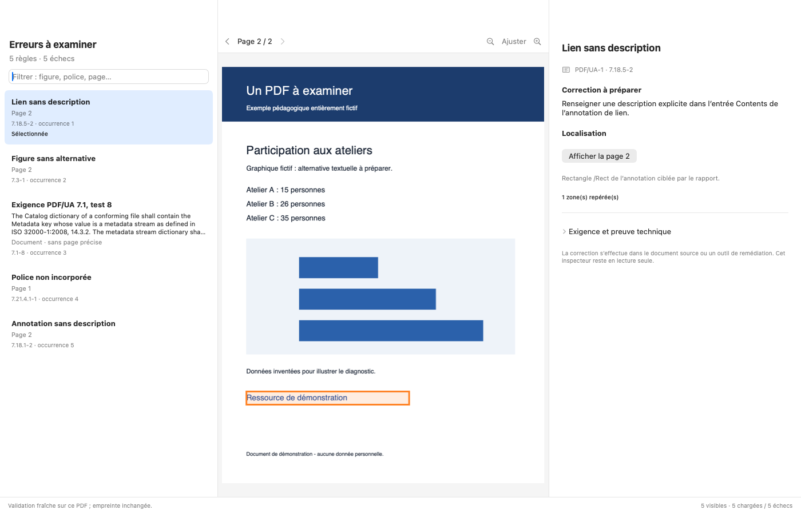

# veraPDF Mac Inspecteur

**Repérez dans vos PDF les erreurs d’accessibilité signalées par veraPDF et préparez leur correction.**

L’application réunit la liste des erreurs, le document et des explications dans
une même fenêtre. Sélectionnez une erreur pour consulter la page concernée et,
quand sa localisation est établie, voir la zone encadrée.

Votre PDF reste sur votre Mac. L’application le consulte sans le modifier.

## Aperçu de l’application

Une figure sans alternative : l’erreur est sélectionnée à gauche, le graphique
est encadré dans le PDF et le conseil apparaît à droite.

Voir aussi un exemple de lien sans description

Le cadre suit cette fois le lien concerné et le panneau explique la description
à renseigner dans l’annotation.

Ces captures réelles utilisent un document entièrement fictif, analysé par
veraPDF. Aucun document utilisateur n’est publié ; la barre d’outils native
macOS n’est pas incluse dans ces captures de la zone de travail.

## À quoi ça sert ?

- Retrouver une figure sans alternative, un lien sans description ou une police non incorporée.
- Comprendre ce qui est signalé et la correction à préparer.
- Passer d’une erreur à sa page sans chercher manuellement dans tout le document.
- Enregistrer le rapport pour conserver une trace du contrôle.

Le contrôle utilise **PDF/UA-1**, un référentiel d’accessibilité des PDF.
L’application vous aide à examiner les défauts techniques détectés ; elle ne
corrige pas automatiquement le document et ne remplace pas une vérification humaine.

## Démarrer

**Compatibilité actuelle : cette version n’est pas prête à être copiée sur
n’importe quel Mac.** Le binaire local vérifié cible Apple Silicon (`arm64`)
et porte un minimum de compilation **macOS 27.0**. Les Mac Intel et les
versions antérieures de macOS ne sont pas validés ; l’ancienne mention
« macOS 14 minimum » était incorrecte pour ce binaire.

Il faut aussi **Python 3.12**, **pikepdf**, **PyMuPDF** et, pour lancer une
nouvelle validation, **veraPDF CLI fonctionnel avec son environnement Java**.
Ces composants ne sont pas embarqués. L’application cherche veraPDF uniquement
à `/opt/homebrew/bin/verapdf`, ou au chemin absolu fourni par
`VERAPDF_COMMAND` : **aucune recherche automatique ni sélection dans l’interface**.
Voir la [compatibilité et la configuration des chemins](docs/compatibilite.md).

Si l’application est déjà installée, ouvrez **veraPDF Mac Inspecteur** depuis
le Finder, ou depuis le Dock si vous l’y avez ajoutée.

**Vous ne l’avez pas encore ?** La version actuelle se construit à partir des
sources : aucun installateur prêt à télécharger n’est proposé dans ce dépôt.
Le [guide d’installation](docs/installation.md) décrit les prérequis et les étapes.

## Votre premier contrôle

1. Cliquez sur **Ouvrir un PDF** et choisissez votre document. L’analyse démarre automatiquement.
2. Attendez la fin du contrôle. Vous pouvez l’interrompre avec **Annuler**.
3. Sélectionnez une erreur dans la liste de gauche.
4. Consultez la page au centre et l’explication à droite, dans **Correction à préparer**.
5. Préparez la correction dans le document source ou dans votre outil de remédiation.
6. Ouvrez le PDF corrigé dans l’application pour effectuer un nouveau contrôle.

Les corrections se font, par exemple, dans le document Word ou PowerPoint
d’origine, ou dans un éditeur PDF adapté. Cet inspecteur vous aide à les situer.

## Se repérer dans la fenêtre

| À gauche : les erreurs | Au centre : votre PDF | À droite : le diagnostic |
|---|---|---|
| Choisissez une occurrence et utilisez le filtre pour retrouver une figure, une police ou une page. | Feuilletez le document, agrandissez l’aperçu ou cliquez sur **Ajuster**. | Lisez le conseil, les limites de localisation et, si nécessaire, dépliez **Exigence et preuve technique**. |

Une **règle** est un contrôle. Une **occurrence** est un échec de ce contrôle
dans le document : une même règle peut donc produire de nombreuses occurrences.
Plusieurs règles peuvent aussi signaler le même objet.

## Comprendre les zones affichées

| Ce que vous voyez | Ce que cela signifie |
|---|---|
| Un cadre orange | Une zone a été établie à partir du document. Examinez-la avec le diagnostic associé. |
| **Localisation partielle** | Le cadre ne couvre qu’une partie du contenu concerné. Examinez aussi le reste de la page. |
| Une page, sans cadre | La page est connue, mais l’application n’a pas établi de zone précise. L’erreur reste à examiner. |
| **Sans localisation dans une page** | Le constat concerne le document entier, ou sa page n’a pas pu être déterminée. |

Une absence de cadre ne signifie pas une absence de problème. Certaines figures
complexes, certains textes ou certaines polices ne peuvent pas être localisés
précisément par cette version.

## Les commandes utiles

| Commande | Quand l’utiliser |
|---|---|
| **Analyser** | Pour refaire un contrôle du PDF ouvert, avec veraPDF. |
| **Importer un XML** | Si vous avez déjà un rapport veraPDF PDF/UA-1 correspondant au PDF ouvert. |
| **Enregistrer le XML** | Pour conserver le rapport à l’emplacement de votre choix. |
| **Rapports** | Pour ouvrir le dossier des rapports ou mettre les anciens rapports générés à la Corbeille. |
| **Annuler** | Pour interrompre un contrôle en cours. Le résultat précédent est conservé. |

Un rapport importé peut être ancien : son association au PDF ne prouve pas
que le document est resté identique depuis le contrôle. Pour contrôler son
état actuel, cliquez sur **Analyser**.

Les rapports générés sont conservés temporairement. Ceux qui dépassent les
50 plus récents ou 30 jours rejoignent la Corbeille ; le rapport affiché reste
protégé. Utilisez **Enregistrer le XML** pour garder durablement une copie
ailleurs. Votre PDF n’est pas concerné par ce nettoyage.

## Questions fréquentes

**Le diagnostic est indiqué comme incomplet.**
Le rapport ou la limite d’affichage ne permet pas de lister tous les échecs.
Le bandeau indique les nombres concernés ; l’application affiche au maximum
2 000 occurrences. Examinez les erreurs disponibles, corrigez-les puis
recommencez le contrôle. Si vous avez importé un ancien rapport, **Analyser**
peut fournir davantage de détails.

**Une explication est en anglais.**
Les règles courantes disposent d’un conseil en français. Pour les autres,
l’exigence originale de veraPDF reste visible, avec la mention
**traduction indisponible** dans le détail.

**L’analyse échoue ou prend trop longtemps.**
Vous pouvez l’annuler ; elle est aussi limitée à environ trois minutes au
total. Le résultat précédent est conservé. Les fichiers acceptés sont limités
à 256 Mio pour un PDF et 64 Mio pour un rapport XML. Pour un validateur
introuvable ou un problème de dépendances, consultez le [guide d’installation](docs/installation.md).

**Il n’y a plus d’erreurs : mon PDF est-il accessible ?**
Si le rapport indique zéro échec, le contrôle automatique n’a pas signalé de
défaut. Une liste vide après filtrage n’a pas cette signification. Il reste
notamment à vérifier la pertinence des alternatives, l’ordre de lecture et
l’utilisation réelle avec un lecteur d’écran.

## En savoir plus

### Les projets officiels veraPDF

| Ressource | Pour quoi faire ? |
|---|---|
| [Organisation veraPDF sur GitHub](https://github.com/veraPDF) | Retrouver les dépôts officiels du projet. |
| [veraPDF-apps](https://github.com/veraPDF/veraPDF-apps) | Consulter le code du validateur en ligne de commande, de l’interface graphique et de l’installateur. Notre application appelle sa commande CLI. |
| [Profils et règles de validation](https://github.com/veraPDF/veraPDF-validation-profiles) | Explorer les règles utilisées par veraPDF et leurs profils. |
| [Corpus de tests](https://github.com/veraPDF/veraPDF-corpus) | Consulter des PDF de test PDF/A et PDF/UA ; ce corpus n’est pas embarqué dans notre application. |

### La documentation de cet inspecteur

La [documentation du projet](docs/README.md) présente la genèse, les ressources
utilisées, les spécifications et les vérifications effectuées. Pour construire
ou tester l’application, consultez [Installation et maintenance](docs/installation.md).

Ce projet indépendant n’est pas un produit officiel veraPDF. Cette version
prend en charge PDF/UA-1 ; elle ne propose pas les profils PDF/UA-2 ou WTPDF.
