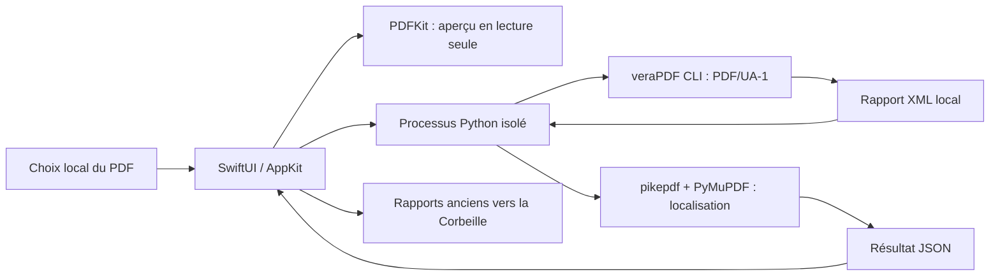

# Spécifications techniques a posteriori

État du code 0.2.0, reconstitué le 15 novembre 2026. Références principales :
[carte du code](../CODEBASE_MAP.md), [modèle](../Sources/Models.swift),
[exécution](../Sources/WorkerTask.swift), [analyse](../worker/analyzer.py),
[localisation](../worker/locations.py) et [tests](../scripts/test.sh).

## Architecture et circulation des données

Le moteur ne fournit pas une API réseau. Swift lance Python directement avec
une liste d’arguments, lit sa sortie standard puis décode le JSON. Les chemins
ne sont pas interpolés dans une commande shell. PDFKit ouvre le PDF pour
l’affichage ; `ReadOnlyPDFView` neutralise les actions PDF et les menus de lien.

## Processus et limites de ressources

| Limite | Implémentation |
|---|---|
| PDF | 256 Mio maximum avant validation. |
| XML | 64 Mio maximum ; DTD et entités refusées par le parseur, y compris en UTF-16. |
| Détails demandés à veraPDF | `--format xml --flavour ua1 --maxfailuresdisplayed 2000`. |
| Occurrences conservées | 2 000 au total ; le total original et la couverture par règle restent exposés. |
| Validation | 120 secondes dans Python. |
| Traitement complet | 180 secondes dans `WorkerTask`, validation et repérage compris. |
| Localisation de structure | Profondeur 80, plafond de parcours de 10 000 nœuds ; abandon signalé comme incomplet. |
| Contenu graphique | Plafond d’environ 100 000 instructions par page ; piles incohérentes ou inventaire interrompu masquent les cadres. |

Le moteur CLI crée une session POSIX avant de lancer le validateur. L’annulation
et le délai global envoient SIGTERM au groupe ; un SIGKILL de secours intervient
après deux secondes si nécessaire. Une demande annulée avant le lancement ne
démarre pas le processus. Un résultat arrivé après une annulation n’est pas publié.

Les textes extraits sont mis en cache par page pendant un traitement. Les
inventaires d’images sont eux aussi mémorisés par page. Aucun cache de contenu
PDF n’est conservé entre deux analyses.

## Contrat de résultat JSON

| Objet | Champs et invariants |
|---|---|
| Résultat | `profile`, `failedChecks`, `passedChecks`, `failedRules`, `pageCount`, `issues`, `coverage`, `complete`. |
| Provenance | `pdfPath`, `pdfHash` SHA-256, `reportPath`, `provenance`, `fresh`. |
| Occurrence | `id`, `clause`, `test`, `title`, `translated`, `advice`, `requirement`, `message`, `context`, `locations`. |
| Localisation | `page` à partir de 1, `rects` sous forme `[x0,y0,x1,y1]`, `precision`, `reason`. |
| Couverture | Clause, test, nombre `displayed` chargé et nombre `total` déclaré. |
| Erreur | Objet JSON `{"error":"message en français"}` et code de sortie non nul. |

`complete` signifie que le détail des échecs est complet au regard du rapport,
pas que le document est accessible. Les identifiants d’occurrences sont des
indices de cette analyse ; ils ne sont pas stables entre validations.

Les rectangles sont en coordonnées PDF avant rotation d’affichage. PDFKit
effectue leur conversion dans la vue. `HighlightLayer` ne les dessine que si
la page courante est celle du rectangle ; l’observateur PDFKit remonte les
changements de page dans la liaison SwiftUI.

## Association du rapport et intégrité

Le moteur exige exactement un job correspondant au PDF choisi. Le chemin
existant peut désigner le même fichier ou un fichier de même empreinte. Si
l’ancien chemin a disparu, nom et taille identiques permettent une association
déclarative de fichier déplacé. Plusieurs candidats sont refusés.

Le profil accepté est `PDF/UA-1 validation profile`, l’état doit être `normal`,
la taille doit être présente et correspondre au fichier, et les compteurs
globaux doivent être des entiers naturels. Un total d’échecs sans détail est
une erreur ; un détail tronqué reste exploitable mais explicitement incomplet.

Le SHA-256 du PDF est comparé avant et après validation et localisation. Ce
contrôle détecte une modification pendant l’opération ; il ne prouve pas les
octets du PDF au moment d’un rapport importé ancien.

## Résolution géométrique et prudence

- Les références d’objets et indices de page proviennent du contexte XML.
- Une annotation n’est localisée que si l’objet appartient aux annotations de la page indiquée.
- Les balises sont parcourues à partir de l’objet ciblé ; la page d’un ancêtre extérieur n’est pas empruntée.
- Les MCID sont reliés aux images directes ; matrices et piles graphiques sont suivies.
- Les MCID répétés, flux externes et contenus non localisés dégradent ou suppriment la précision.
- Une découpe rectangulaire contenante conserve l’image ; l’arrondi toléré est de 0,0001 point, avec intersection finale. Un rognage réel, une découpe non établie ou une découpe par texte masque le cadre.
- Le prolongement d’un chemin après W invalide la simplification rectangulaire.
- Les polices sont rapprochées par nom normalisé, avec origine de CropBox et rotation prises en compte ; les homonymes et unités de page particulières restent sans cadre.

Les images intégrées, Form XObjects, masques et tracés ne bénéficient pas d’une
localisation générale. La boîte d’une image n’atteste pas la visibilité de
chaque pixel de son contenu. Les limites restent décrites avec les zones.

## Stockage et distribution

Les rapports générés sont stockés dans
`~/Library/Application Support/Inspecteur veraPDF/Rapports/`. Le nom interne
historique est conservé lors du renommage pour garder l’accès aux rapports.
Le répertoire est créé avec le mode 0700, les nouveaux XML avec 0600.

Après une analyse réussie, la rétention déplace à la Corbeille les rapports
générés au-delà des 50 plus récents ou de 30 jours. Elle ne sélectionne que le
motif de nom du moteur, ignore les liens symboliques et protège le rapport
affiché. Le menu de nettoyage applique la même sélection, sans conservation
des autres rapports générés. Les exports utilisateur ailleurs restent intacts.

Le paquet `build/veraPDF Mac Inspecteur.app` reçoit une signature ad hoc.
Son identifiant historique `org.alex.verapdf-inspecteur` reste stable. Python
et veraPDF ne sont pas embarqués ; le lien Homebrew de Python évite un chemin
Cellar versionné. Le binaire de livraison exclut la capture de diagnostic ;
`DIAGNOSTICS=1 bash scripts/build.sh` permet une construction dédiée.

Depuis la correction 0.2.1, le paquet local observé est uniquement `arm64`,
avec `minos 14.0` et un plist à `14.0`. Le script fixe une cible de déploiement
commune et vérifie leur cohérence ; l’exécution sur macOS 14 reste à qualifier.
Python est résolu dans le `PATH` à la construction si un nom court est fourni,
puis son chemin absolu est mémorisé. Les chemins ne sont pas découverts
automatiquement au lancement ; voir les
[constats de compatibilité et règles de configuration](compatibilite.md).

## Qualification

[scripts/test.sh](../scripts/test.sh) exécute les tests Python, le harnais PDFKit
et les harnais d’exécution et d’actions Swift. Ces derniers contrôlent les sous-processus,
l’annulation, le délai global, l’état préservé après refus et la sélection du
cache avec une Corbeille simulée. Les verdicts Fable sont historiques ; les
corrections mineures ultérieures ont leurs propres tests, pas une nouvelle
certification du relecteur. Voir la [recette](recette.md).
